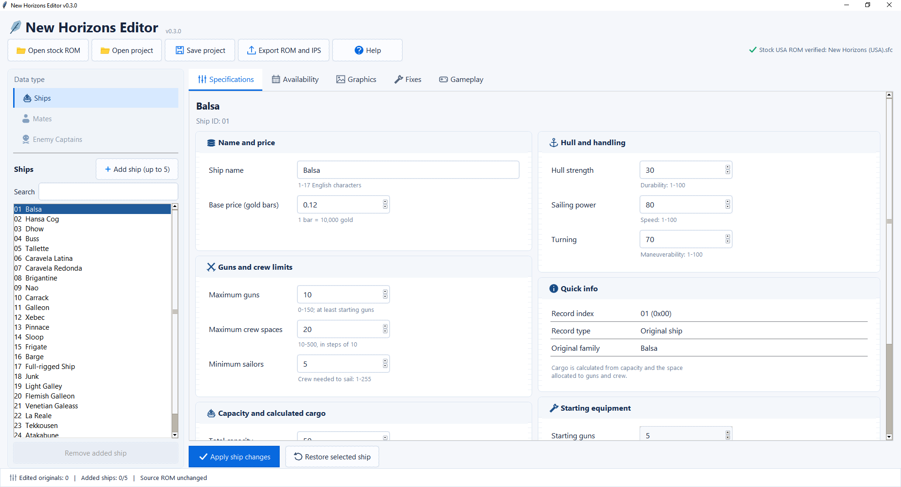

# New Horizons Ship Editor

**Version 0.3.0 Beta · October 15, 2026 · Windows**

A ship-data editor for the original USA SNES release of *Uncharted Waters: New Horizons*.

Edit the original game's 25 ship classes and add up to five new classes. Save your work as a project, then export a modified ROM for testing or an IPS patch for sharing.


## Screenshot




## Getting started

1. Extract the entire Windows release ZIP to a folder.
2. Double-click **New Horizons Ship Editor.exe**. Python is not required.
3. Click **Open stock ROM** and select your original USA game ROM: `.sfc`, `.smc`, or a ZIP containing exactly one compatible ROM.
4. Select a ship from the list and change its values.
5. Click **Apply ship changes** or select another ship to keep the edits.
6. Click **Restore selected ship** to return an original ship to its stock values. For an added ship, this restores the selected original type's starting specifications while keeping its name and availability.
7. Click **Save project** to save a JSON project you can edit later.
8. Click **Export ROM and IPS**, choose a **new** `.sfc` filename, and test the exported game in your SNES emulator.

To reopen a project, first open the original USA ROM, then click **Open project** and choose your saved `.json` file.

The window supports vertical and horizontal scrolling when its contents do not fit. Use the scrollbars or mouse wheel; **Shift + mouse wheel** scrolls horizontally. Fields reached with **Tab** are brought into view automatically. The ship and port lists have their own scrollbars.

The editor groups settings into name/price, handling, gun/crew limits, capacity, and starting equipment. Availability contains industry and port settings; Graphics contains artwork settings. Cargo is calculated and read-only. The ship list and settings scroll independently; Add/Remove and Apply/Restore remain visible. Search filters the ship list as you type. Capacity and starting equipment stay visible below the main panels; scroll to reach them. Mates and Enemy Captains are reserved for future versions.

## Adding a new ship

1. Select an original ship and click **Add ship (up to 5)** to copy its starting specifications into a new, independent class.
2. On **Specifications**, set its name, stats, price, total capacity, factory guns, and factory crew spaces. Remaining capacity becomes cargo.
3. On **Graphics**, choose an original visual family. This changes the reused graphics and description, not the current stats.
4. Select ports with **Ctrl-click** and set the minimum industry. Port rows show starting industry. Fixed capitals cannot be developed, so the editor rejects requirements above their starting industry.
5. Apply changes, save the project, and export to a new filename.

Selected ports are potential building locations: the ship appears only when the port meets the minimum industry requirement. Port rows show stock starting industry, not the current value in your save.

The industry requirement is shared by all selected ports for a ship. New classes may appear occasionally in fresh used stock at eligible ports; cached offers need not update immediately. They are not automatically assigned to enemy fleets.

Projects saved by earlier editor versions still load. New saves use project format version 6.

## What you can edit

### All 25 original ship classes

- Ship name
- Hull strength
- Turning
- Sailing power
- Maximum guns
- Minimum sailors
- Maximum crew spaces
- Base purchase price
- Total capacity (cargo is calculated automatically)
- New-build ports and minimum industry

Prices are entered in **gold bars**: **1 bar = 10,000 gold**. For example, 2.5 bars = 25,000 gold.

### Up to five added ship classes

- All the specifications and base price listed above
- Total capacity and factory guns / crew spaces
- Factory cargo, calculated from the remaining capacity
- Original ship used for the portrait, map/battle graphics, and description
- One or more ports where the ship can be built
- Minimum industry, shared by all selected ports

**Total capacity is editable; both cargo displays are read-only.** Shipyard cargo is total capacity minus maximum guns and maximum crew spaces, matching the shipyard screen. Cargo when first built is total capacity minus starting guns and starting crew spaces. These can differ on stock ships such as Buss and Sloop. Changing capacity or allocations recalculates cargo automatically. Starting guns and crew allocations remain read-only for the original 25 ships and editable for added ships.

Adding ships, changing original new-build availability, importing custom portraits, or enabling Repair Safeguard or Fleet Control expands the exported game to **4 MiB** and preserves every original ship entry. Native construction time follows hull strength and port industry.

## Custom ship portraits

On **Graphics**, click **Import PNG** for any original or added ship. The converter resizes to **64x48 pixels** with nearest-neighbor sampling and maps colors to the original game's **16-color ship palette**. Transparent pixels use the palette-zero background. A correctly sized PNG gives the most predictable result.

Review the exact converted pixels, then click **Use portrait** or **Cancel**. The displayed preview is enlarged without smoothing. **Restore portrait** removes only the custom picture; **Restore selected ship** also restores its portrait along with the other ship settings.

Converted tile data is embedded inside the project, so the source PNG is not needed when reopening it or moving it to another PC. Custom portraits expand the export to 4 MiB. Each image uses a reserved slot and the game's existing decompressor. Map and battle icons, descriptions, and ship specifications are controlled separately.

## Original ship availability

On **Availability**, select new-build ports and the minimum industry for any original ship. Used-ship locations and industry rules stay unchanged. Original map/battle graphics remain fixed; portraits can be imported separately.

The starting selections come from the stock game. Existing locked capital offers are preserved; new offers that a fixed capital cannot unlock are rejected. Original ships can have no selected ports, removing them from new-build offers. Each port supports up to 16 new-build types, including added ships.

**Restore selected ship** restores both stock specifications and availability. Projects save availability separately. Changing original availability expands the export to 4 MiB.

## Repair Safeguard

On **Fixes**, leave **Repair Safeguard** checked to prevent excessive gold or lumber charges when lowered ship stats conflict with an existing save. Original repair rates are preserved. Uncheck it to keep original repair behavior.

The setting is saved with your project and recorded in the export report. Older projects load with the safeguard enabled. Enabled exports use 4 MiB even without added ships; exports without additions, original availability changes, or either option remain 2 MiB. The editor does not modify save files.

## Fleet Control (Experimental)

On **Gameplay**, enable **Fleet Control (Experimental)** to control your mates’ ships manually in battle. The camera follows each manual ship’s turn and returns to the flagship when its turn comes back.

At the main battle command menu, press **Select** to toggle mate automation, release the button, then press **A** to dismiss the confirmation. Each new battle starts in manual mode. Your flagship remains manual, enemies retain their AI, and duel commands remain available.

The option is off by default and saved with the editor project. Earlier projects load with it off. Enabled exports use 4 MiB. Runtime mode is transient; the save-file format stays unchanged. Native control/camera checks have been performed, but full scripted-battle and duel playthrough compatibility is still being tested.

## Export files

Each export creates three files with the name you choose:

| File | Purpose |
| --- | --- |
| `My Ships.sfc` | Modified, headerless ROM for emulator testing |
| `My Ships.ips` | IPS patch for the original headerless USA ROM |
| `My Ships.changes.json` | Changes, checksums, and validation information |

The exported `.sfc` is already patched; do not apply the IPS to it again. **Share the `.ips` patch, not the modified ROM**, when distributing your changes.

The editor does not overwrite your source ROM or save-game files. It refuses to overwrite existing export files. Saving over an existing JSON project backs up the prior project as `.json.bak`. Projects store your edits, not the ROM itself.

## Supported game version

This beta supports only the original USA ROM revision with the following **SHA-256** checksum after removing any 512-byte copier header:

```text
64bc4707f422661a66618088887e2363a5f896ea683c58984fffd96dd21ab5f0
```

Accepted inputs:

- Original USA `.sfc` or `.smc` ROM
- The same ROM with a 512-byte copier header
- ZIP containing exactly one compatible `.sfc` or `.smc` ROM

Previously modified ROMs, other regions or revisions, and ZIPs containing multiple ROM files are not accepted. Any accepted copier header is removed from the exported `.sfc`. IPS patches must be applied to the original **headerless** USA ROM.

## Editing limits

| Field | Allowed values |
| --- | --- |
| Ship name | 1–17 printable ASCII characters; no percent sign (`%`) |
| Hull strength | 1–100 |
| Turning | 1–100 |
| Sailing power | 1–100 |
| Maximum guns | 0–150; cannot be reduced below factory-fitted guns |
| Minimum sailors | 1–255; cannot exceed maximum crew |
| Maximum crew | 10–500, in multiples of 10; cannot be reduced below factory crew allocation |
| Base price | 0.001–32 bars (10–320,000 gold), in 0.001-bar steps |
| Cargo capacity (shipyard) | Nonnegative; total capacity minus maximum gun/crew spaces |
| Factory cargo spaces | Nonnegative; total capacity minus factory gun/crew allocations |
| Total capacity | 1–2,000; must cover maximum gun and crew spaces |

Additional limits for **new ships**:

| Field | Allowed values |
| --- | --- |
| Added classes | 1–5; IDs 25–29, preserving all 25 original classes |
| Total capacity | 1–2,000 |
| Factory guns | Must fit the maximum gun limit and total capacity |
| Factory crew | Must fit the minimum/maximum crew limits and total capacity |
| Minimum industry | 0–1,000, in multiples of 10 |
| Ports | At least one compatible port; unreachable capital requirements are rejected |

Original stock exceptions are preserved unless you modify the relevant fields. The editor checks new values before saving or exporting.

## Limitations and testing

This beta adds up to five ship classes and edits existing ship data. It does not:

- Import custom map/battle sprites
- Change factory guns or crew allocations of the original 25 classes
- Assign new ships to enemy fleets
- Edit items, shops, stories, or encounters
- Read patched games or convert saves from other expanded-ship mods

Added classes reuse original map/battle artwork and descriptions; portraits can be replaced. The exporter installs the engine hooks needed for additional records, graphics, and stock lists. Other gameplay rules remain stock; separate campaign patches are not included.

Purchase prices follow the game's original material, port, resale, and bargaining rules. Ships already owned in a save may keep their existing condition and fitted layout. Data edits can also affect enemy ships using the same ship-class tables.

The exporter validates data and verifies that its IPS reconstructs the output ROM. Release checks passed for stock-ROM edits, projects, the packaged Windows application, added-ship records, new/used stock, capture, normal SRAM save/load, construction timers, map/battle icon selection, cold boot, and all five actual shipyard portrait previews.

These checks use controlled fixtures. Construction pickup, normal voyages, and complete campaign compatibility have **not been fully playtested**. Keep original ROMs and saves backed up and test changes before committing to a long playthrough.

## Save compatibility

Restart the emulator after changing ROMs. Use a normal in-game save or start a new game; do not load an emulator save state from another ROM.

**Keep added ships in the same order after playing a project.** Removing a class renumbers later additions and can reinterpret their hull IDs in that mod's saves. Rename or edit an existing addition instead of removing and recreating it. The editor does not convert saves made with other expanded-ship mods.

## Project, license, and disclaimer

- [Project page and downloads](https://github.com/erich121/uncharted-waters-new-horizons-editor)
- [Report bugs or request features](https://github.com/erich121/uncharted-waters-new-horizons-editor/issues)
- [Developer instructions](DEVELOPMENT.md)
- [Release history](CHANGELOG.md)
- [Plain-text instructions](README.txt)

Source code is licensed under the [MIT License](LICENSE).

Ship portrait decompression is adapted from [Gilmok’s UWNHRando](https://github.com/Gilmok/UWNHRando), used under the MIT License. See [UWNHRando.LICENSE](UWNHRando.LICENSE).

Image processing and portrait conversion use Pillow. See [Pillow.LICENSE](Pillow.LICENSE).

This is an unofficial fan-created tool, unaffiliated with and not endorsed by KOEI or Koei Tecmo. No game ROM is included. Supply your own legally obtained compatible ROM.
