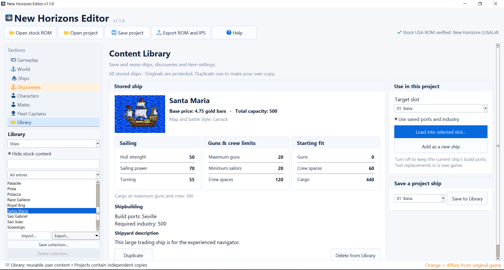

# New Horizons Editor

**Version 1.1.0 · Windows**

New Horizons Editor is an open source ROM editor, content creator, and randomizer for the USA SNES version of *Uncharted Waters: New Horizons*. It provides a graphical interface for modifying ships, characters, ports, economies, discoveries, and gameplay mechanics without requiring programming or manual ROM editing.

The editor supports thousands of customizable values, along with custom presets, seeded randomization, and AI assisted game creation. Version 1.1.0 includes **5 more in game ship slots**  **35 custom ship designs** and **98 new discoveries**, complete with original artwork and descriptions.

Custom content can be stored in a personal Library, reused across projects, or shared with other players. Complete game configurations can also be exchanged through project files, allowing others to load, modify, and build upon existing creations.

**[Download the Latest Release](https://github.com/erich121/uncharted-waters-new-horizons-editor/releases/latest)**

---

## What's New in v1.1.0

- **Custom Ships:** 35 new ship designs with original shipyard artwork, specifications, and descriptions. Replace all 25 original classes, add up to 10 additional ship types, or mix your favorites with the existing roster.
- **New Discoveries:** 98 custom discoveries with original artwork, names, and historical descriptions. Explore familiar locations and find something entirely different.
- **AI Game Creation:** Don't feel like going through thousands of settings? Load a preset or have AI create a game tailored to your preferences. The editor generates a guide containing the game's settings and reference data. Give it to your favorite AI assistant, describe what you want, and import the resulting configuration back into the editor.
- **Full Randomizer:** Randomize multiple game systems at once, including mates, captains, trade goods, shop inventories, and shipbuilding locations. Use reproducible seeds or blind mode to keep the changes a surprise.
- **Content Library:** Create, collect, and organize custom ships, discoveries, and item configurations. Import and export collections to share your creations with other players.


## Ship Editing


## Custom Discoveries


## Content Library




## What You Can Change

- **Ships:** Statistics, prices, equipment, construction ports, industry requirements, portraits, and descriptions.
- **Characters:** Starting attributes, levels, skills, mates, and fleet captains.
- **World:** Port economies, investments, trade goods, shop inventories, and discoveries.
- **Gameplay:** Starting gold, campaign length, construction times, and discovery difficulty.
- **Randomization:** Individual seeded randomizers, blind shuffles, or the Full Randomizer.
- **Naval Combat:** Experimental fleet control and custom national fleet configurations.

## Get Started

1. Extract the Windows ZIP and open **New Horizons Ship Editor.exe**.
2. Choose **Open stock ROM** and select the original USA game (`.sfc`, `.smc`, or ZIP).
3. Choose a preset, load a shared project, or select a section and enable **Use custom values** to edit.
4. Choose **Save project** to keep or share your configuration, or **Export ROM and IPS** to create a game for your emulator.

Orange marks changes from the original game. Valid edits apply automatically, and restore controls return values to their original settings. Turning off **Use custom values** locks editing without discarding your changes.

Selecting a preset replaces the current configuration. Your personal Content Library remains separate from your projects.

## Before You Play

Start a new game when testing character and town changes. Keep additional ship classes in the same order when continuing an existing save, and back up your saves. The editor does not modify `.srm` files.

The exported `.sfc` is already patched. Share the `.ips` file rather than the game ROM. Existing export files are protected from overwriting.

For troubleshooting, choose **Help > Open log folder**. Logs are stored in `%LOCALAPPDATA%\New Horizons Editor\Logs`.

For additional instructions and troubleshooting, see [README.txt](README.txt).

## Source

Install Python 3.12 or newer, then run:

```sh
python -m pip install -r mod_tool/requirements.txt
python mod_tool/app.py
```

Python is not required for the Windows executable. Testing tools require your own compatible ROM. See [Testing](tools/Testing.md).

## Project

Created and maintained by **erich121**.

[GitHub Repository](https://github.com/erich121/uncharted-waters-new-horizons-editor) · [Latest Release](https://github.com/erich121/uncharted-waters-new-horizons-editor/releases/latest)

Released under the [MIT License](mod_tool/LICENSE). Ship portrait decompression incorporates work from Gilmok's UWNHRando project. See the included license files for additional acknowledgments.

## ROM Disclaimer

New Horizons Editor is an independent fan project and is not affiliated with Koei Tecmo.

The editor does not include the original game. Users must provide their own legally obtained USA SNES ROM. All original game assets remain the property of their respective owners.
