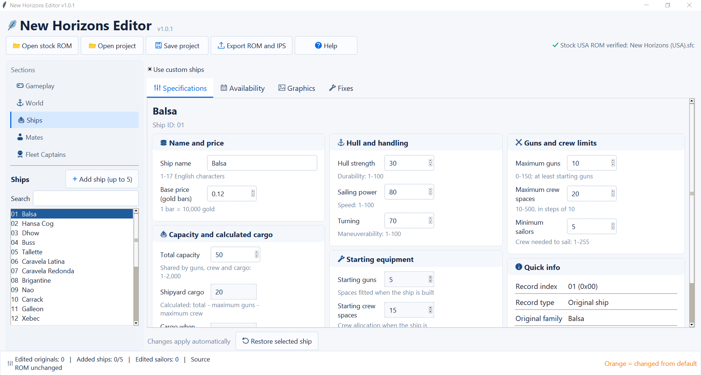
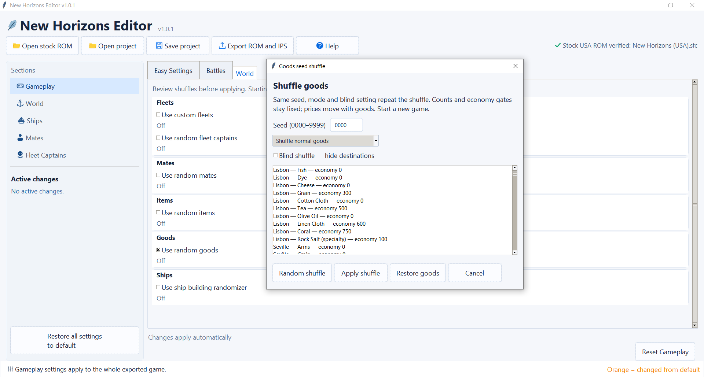

# New Horizons Editor

**Version 1.0.1 — Windows**

A fan-made ROM editor for the original USA SNES version of **Uncharted Waters: New Horizons**. Customize the game, try a preset adventure, or shuffle familiar content to make your next playthrough feel different.

## Screenshot

## Screenshot

## What can you change?

- **Ships:** Edit the original 25 ship types, their stats, prices, artwork, and shipyard availability. You can also create up to **5 additional ship types**.
- **World and trade:** Change port development, trade-good availability, and shop inventories; explore information about the original ports and discoveries.
- **Mates and fleets:** Edit recruitable characters and configure fleet-related options.
- **Presets and shuffles:** Choose from **13 built-in presets**, or use a four-digit seed to shuffle eligible mates, items, goods, and shipbuilding locations. You can combine compatible settings.

## Getting started

1. Download the latest [Windows release](https://github.com/erich121/uncharted-waters-new-horizons-editor/releases) and extract the ZIP.
2. Run **`New Horizons Ship Editor.exe`**.
3. Click **Open stock ROM** and select your own original USA game ROM.
4. Choose a preset under **Gameplay → Easy Settings**, or customize the individual sections yourself.
5. Review your changes, then choose **Export ROM and IPS**.
6. Play the exported `.sfc` file in your SNES emulator.

Use **Save project** to keep your editable settings. To reopen a project later, load the original ROM first and then choose **Open project**.

## Important notes

- **Only the original USA ROM is supported.** The editor accepts `.sfc`, `.smc`, or a ZIP containing one compatible ROM. Previously modified ROMs are not supported as input.
- **Start a new game** when changing starting characters, port development, or goods and shop locations. Old emulator save states may not work with a different modified ROM.
- If you add custom ships, keep their order unchanged once you've started a campaign; changing ship IDs can affect saved games.
- New ship portraits use **64 × 48 pixel, 16-color artwork**. Custom portraits do not replace the game's map or battle sprites.
- The six original stories remain unchanged. Some fleet features are experimental.
- **Keep backups.** The editor does not change your original ROM.

Export creates a playable `.sfc`, a shareable `.ips` patch, and a `.changes.json` report. **Share the IPS patch, not copyrighted ROM files.** Apply patches to the original headerless USA ROM, never to an already-modified ROM.

## Help and project links

- [Downloads and source code](https://github.com/erich121/uncharted-waters-new-horizons-editor)
- [Report a bug or suggest a feature](https://github.com/erich121/uncharted-waters-new-horizons-editor/issues)
- [Release notes](CHANGELOG.md) · [Developer information](DEVELOPMENT.md) · [MIT License](LICENSE)

Ship-portrait decompression uses work adapted from [UWNHRando](https://github.com/Gilmok/UWNHRando); see `UWNHRando.LICENSE`. Portrait processing uses Pillow; see `Pillow.LICENSE`.

*Independent fan project. Not affiliated with or endorsed by Koei Tecmo. No game ROM is included.*

**Created and maintained by [erich121](https://github.com/erich121).**
